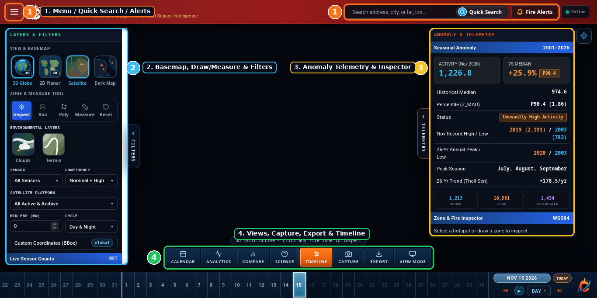
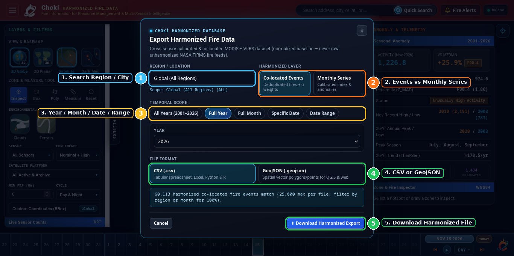
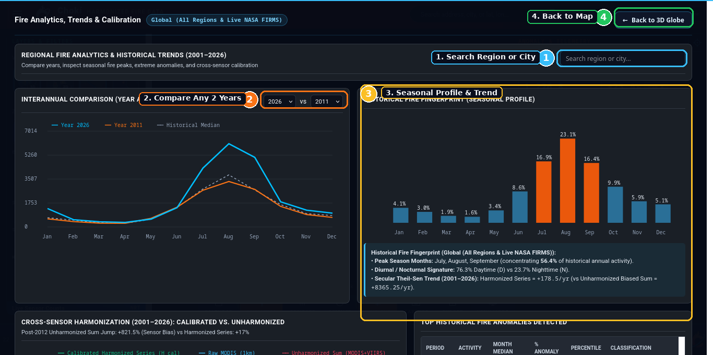

<p align="center">
  
</p>

# Choki — Global Fire Intelligence (GFI)

[English](README.md) | [Español](README-es.md)


**Choki** (Global Fire Intelligence — GFI) es una plataforma web de inteligencia geoespacial que reconstruye por primera vez una serie temporal histórica continua, limpia y armonizada de incendios forestales de **2000 a 2026**, fusionando detecciones térmicas de los sensores satelitales **MODIS** y **VIIRS** sin duplicidad de información.

---

## Tabla de contenidos

- [Descripción del proyecto y problemática](#descripción-del-proyecto-y-problemática)
- [Estado del proyecto](#estado-del-proyecto)
- [¿Cómo funciona?](#cómo-funciona)
- [Beneficios y funcionalidades clave](#beneficios-y-funcionalidades-clave)
- [¿Qué esperamos lograr?](#qué-esperamos-lograr)
- [Demostración visual](#demostración-visual)
- [Herramientas, lenguajes y stack tecnológico](#herramientas-lenguajes-y-stack-tecnológico)
- [Arquitectura y estructura del repositorio](#arquitectura-y-estructura-del-repositorio)
- [Prerrequisitos](#prerrequisitos)
- [Instalación y ejecución local](#instalación-y-ejecución-local)
- [Guía paso a paso con Docker para jueces](#guía-paso-a-paso-con-docker-para-jueces)
- [Validación científica y pruebas](#validación-científica-y-pruebas)
- [Compilación y despliegue](#compilación-y-despliegue)
- [Equipo y créditos](#equipo-y-créditos)
- [Licencia](#licencia)
- [Soporte y documentación](#soporte-y-documentación)
- [Referencias](#referencias)

---

## Descripción del proyecto y problemática

Nuestra plataforma atiende uno de los problemas ambientales más críticos registrados en la Unión Europea durante 2025. Los análisis basados en datos satelitales del **Sistema Europeo de Información sobre Incendios Forestales (EFFIS)** revelaron que **1,079,538 hectáreas** —una superficie aproximadamente equivalente al tamaño de Chipre— fueron devastadas por el fuego en diversos países de la UE.

Actualmente, analizar la evolución real a largo plazo de los incendios resulta impreciso debido a que los archivos satelitales históricos presentan:

- **Discontinuidades metodológicas entre sensores:** MODIS (`MCD14ML` / `MCD14DL`, resolución nominal de 1 km, activo desde la década de 2000) y VIIRS (`VNP14IMGML`, `VJ114IMGML`, `VJ214IMGML`, resolución de banda I de 375 m, activo desde 2012) generan conteos y métricas de potencia radiativa estructuralmente distintos.
- **Falsos negativos y falsas alarmas:** La cobertura nubosa oculta firmas térmicas reales, mientras que reflejos solares o actividades industriales detonan anomalías que no corresponden a incendios forestales.
- **Duplicidad por solapamiento entre sensores:** La aplicación NASA FIRMS combina VIIRS y MODIS con un umbral estático de 1 km, lo que produce información duplicada e inutilizable para análisis longitudinales limpios.

Para unificar los registros multisensor en una sola línea temporal coherente, **Choki** aplica la **fórmula de Haversine** para distancia esférica junto con una regla de geometría dinámica:

$$d \le r_i + r_j + \delta$$

donde $r_i$ y $r_j$ representan los radios efectivos de píxel calculados a partir de la geometría `scan * track` del sensor y $\delta$ representa la tolerancia de apuntamiento entre sensores (`0.65 km` en el motor de armonización dentro de una ventana de colocación de `180` minutos).

---

## Estado del proyecto

- **Estado actual:** Prototipo full-stack funcional con archivo científico precargado que se ejecuta localmente mediante un servidor HTTP/REST en Python (`server.py`, puerto por defecto `8766`) y un cliente web con soporte offline (`web/`).
- **Base de datos precargada (`data/gfi_fire_intelligence.sqlite`, 191 MB):** Incluye 6 macrorregiones de referencia (`MX-CHH`, `BR-AMZ`, `US-CAL`, `AU-NSW`, `RU-SAK`, `ES-IBE`), `281,280` registros espaciales en `raw_hotspots` (`hotspots_rtree`), `89,994` eventos térmicos deduplicados (`thermal_events`), `72` modelos en `calibration_models` y `1,872` registros en `harmonized_monthly_series`.
- **Validación científica automatizada:** `12` pruebas unitarias y matemáticas aprobadas en `tests/test_scientific_pipeline.py`.

---

## ¿Cómo funciona?

1. **Ingesta multisensor (`pipeline/ingestor.py`, `pipeline/schemas.py`):** Lee archivos históricos y datos en tiempo casi real (NRT) de NASA FIRMS (`MCD14ML`, `MCD14DL`, `VNP14IMGML`, `VJ114IMGML`, `VJ214IMGML`) en bloques de 5 días, normalizando niveles de confianza, satélites y la geometría de huella `scan * track` mediante esquemas Pydantic v2.
2. **Indexación espacial (`pipeline/database.py`):** Almacena las detecciones en SQLite respaldado por un índice espacial nativo **R-Tree** (`hotspots_rtree`) para resolver consultas por caja delimitadora o polígono en milisegundos.
3. **Colocación dinámica y calibración (`pipeline/harmonizer.py`):** Agrupa detecciones bajo la regla esférica de Haversine ($d \le r_i + r_j + \delta$) y una ventana temporal (`180` minutos) para consolidar `thermal_events` únicos, evitando el doble conteo entre MODIS y VIIRS y ajustando factores de calibración (`H_grid`, `H_cal`, `FRP_harm`).
4. **Analítica estadística y auditoría neuronal (`pipeline/analytics.py`, `pipeline/choki_ai.py`):** Calcula huellas históricas de fuego, calendarios mensuales, clasificación de anomalías Z-MAD y pendientes de tendencia Theil-Sen. Incorpora redes neuronales propias (`TinyFireTransformer` con autoatención de 2 cabezas + GELU y `VerifierNetGatedResMLP` con bloques residuales GLU dentro de `DualFireEnsemble`) construidas sobre un motor autograd propio (`MicroValue`) para auditar la calidad de la armonización y responder consultas geoespaciales.
5. **Visualización interactiva y exportación (`server.py`, `web/`, `pipeline/exporter.py`, `pipeline/harmonized_exporter.py`):** Sirve la interfaz web (HTML5/CSS3/JS + React 18.3.1 + Service Worker PWA) con calendarios codificados por color, animaciones espaciales y exportación directa a formatos CSV y GeoJSON (RFC 7946).

---

## Beneficios y funcionalidades clave

- **Más de 20 años de historia unificada (2000–2026):** Conecta MODIS y VIIRS en una sola serie continua libre de alertas duplicadas.
- **Calendarios interactivos por color y animaciones espaciales:** Permiten inspeccionar severidad estacional, picos anómalos y evolución geográfica sobre macrorregiones o polígonos personalizados.
- **Exportaciones geoespaciales auditables:** Genera archivos **CSV** y **GeoJSON (RFC 7946)** listos para análisis GIS y reportes científicos (`pipeline/exporter.py`, `pipeline/harmonized_exporter.py`).
- **Modo offline y sincronización NRT:** Incluye Service Worker (`web/sw.js`), respaldo estático (`web/data/static_fallback.json`) y un hilo de sincronización automática cada `900` segundos (`15` minutos) cuando se configura `FIRMS_MAP_KEY`.

### Beneficios

- Elimina la inflación artificial de conteos al comparar registros previos a 2012 (MODIS) con observaciones posteriores (VIIRS).
- Acelera el diagnóstico de riesgo ecológico para investigadores, protección civil y planeadores territoriales.
- Funciona de manera autónoma en equipos convencionales sin requerir servidores GIS pesados.

---

## ¿Qué esperamos lograr?

1. Proveer una línea base científica, reproducible y transparente para medir la progresión real de los incendios forestales en zonas vulnerables —como las regiones de la Unión Europea afectadas en 2025— sin sesgos instrumentales.
2. Democratizar el acceso a datos armonizados de NASA FIRMS mediante calendarios visuales, mapas animados y exportación abierta.
3. Unir geometría esférica, estadística robusta (Theil-Sen / Z-MAD) y auditoría con redes neuronales ligeras (`choki_ai.py`) en una plataforma rápida y portable.

---

## Demostración visual

### Vista general y línea temporal armonizada


### Modal de exportación geoespacial (CSV / GeoJSON)


### Analítica, calendario de incendios y auditoría neuronal


---

## Herramientas, lenguajes y stack tecnológico

| Categoría | Perfil del proyecto e implementación verificada en el repositorio |
| :--- | :--- |
| **Herramientas de desarrollo (Development Tools)** | Antigravity, utilidades estándar de Python, Git |
| **Infraestructura y alojamiento (Infrastructure & Hosting)** | Alojamiento objetivo: Amazon Web Services (AWS) *(manifiestos de despliegue aún `[POR DEFINIR]` en este repositorio)*; servidor local en `server.py` (`ThreadingHTTPServer`, puerto `8766`) |
| **Backend y API** | **Python** (`server.py`, `pipeline/*`, `scripts/*`) y **C++** *(declarado en el stack del proyecto; la ejecución nativa en C dentro del repo corresponde al motor espacial SQLite R-Tree, sin archivos `.cpp` independientes actualmente en el árbol)* |
| **Frontend e interfaz (Frontend & UI)** | **HTML5, JavaScript (ES6+), CSS3**, **React 18.3.1** (`web/vendor/` + `web/js/choki-react.js`), **html2canvas 1.4.1**, Manifiesto PWA y Service Worker (`web/manifest.webmanifest`, `web/sw.js`) |
| **Lenguajes de programación** | Python (`3.14.10` verificado), JavaScript, HTML, CSS *(C++ en el perfil técnico declarado del proyecto)* |
| **IA y Machine Learning** | Motor autograd puro en Python (`MicroValue`), `TinyFireTransformer` (autoatención de 2 cabezas + GELU), `VerifierNetGatedResMLP` (bloques residuales GLU) y `DualFireEnsemble` en [`pipeline/choki_ai.py`](pipeline/choki_ai.py) |
| **Procesamiento de datos y geoespacial** | Python (`numpy 2.5.4`, `orjson 3.13.0`, `pydantic 2.14.2`, `sqlite3 3.54.0` R-Tree), geometría esférica Haversine, pendiente Theil-Sen, puntuación Z-MAD, GeoJSON RFC 7946 |
| **Tareas asíncronas y caché** | Hilo demonio en Python (`_start_nrt_auto_sync_loop(900)` en `server.py`), compresión gzip, caché HTTP por `ETag`, caché offline del Service Worker (`web/sw.js`) |
| **Software y diseño** | HTML5, CSS3, React e identidad vectorial SVG (`web/assets/logo/project-logo.svg`) |
| **Hardware** | Estación de trabajo estándar x86_64/ARM64 o instancia en la nube (ejecución en CPU, sin GPU dedicada requerida) |
| **Fuentes de datos** | NASA FIRMS (`MCD14ML`, `MCD14DL`, `VNP14IMGML`, `VJ114IMGML`, `VJ214IMGML`) y referencia de incendios en la UE 2025 de EFFIS (`1,079,538 ha`) |

---

## Arquitectura y estructura del repositorio

```text
.
├── server.py                       # Servidor HTTP/REST, cabeceras CSP, gzip/ETag y bucle NRT (puerto 8766)
├── PROJECT_BLUEPRINT.md            # Especificación científica y arquitectónica
├── LICENSE                         # Licencia MIT (Copyright 2026 Chokí Harmonized Fire Data)
├── CREDITS.md                      # Integrantes del equipo, fuentes de datos y librerías
├── BUILD.md                        # Instrucciones de ejecución local y en contenedor Docker
├── pipeline/
│   ├── __init__.py                 # Versión del paquete (1.0.0)
│   ├── schemas.py                  # Validación Pydantic v2 y geometría de píxel scan*track
│   ├── database.py                 # Esquema SQLite + R-Tree y 6 macrorregiones de referencia
│   ├── ingestor.py                 # Ingesta CSV/API de NASA FIRMS y sincronización por bloques de 5 días
│   ├── harmonizer.py               # Colocación Haversine (d <= r_i + r_j + delta) y calibración
│   ├── analytics.py                # Calendarios de quema, Z-MAD, Theil-Sen y consultas espaciales
│   ├── choki_ai.py                 # Redes neuronales (TinyFireTransformer, VerifierNetGatedResMLP)
│   ├── exporter.py                 # Exportador CSV/GeoJSON de focos crudos y eventos
│   └── harmonized_exporter.py      # Exportador CSV/GeoJSON (RFC 7946) de series armonizadas
├── scripts/
│   ├── sync_firms_area.py          # Utilidad CLI de sincronización regional con NASA FIRMS
│   └── sync_global_firms_live.py   # Script CLI de sincronización global en vivo
├── tests/
│   └── test_scientific_pipeline.py # 12 pruebas unitarias y de validación matemática
├── data/
│   └── gfi_fire_intelligence.sqlite # Base de datos SQLite + R-Tree precargada (191 MB)
└── web/
    ├── index.html                  # Interfaz SPA principal
    ├── js/                         # Lógica de aplicación (app.js) y componentes React (choki-react.js)
    ├── vendor/                     # Librerías locales React 18.3.1 y html2canvas 1.4.1
    ├── data/static_fallback.json   # Respaldo estático para modo offline
    ├── assets/                     # Logotipo y capturas tutoriales
    ├── manifest.webmanifest        # Manifiesto PWA
    └── sw.js                       # Service Worker para caché offline
```

---

## Prerrequisitos

- **Para ejecución local nativa:**
  - Python `3.10+` (verificado en Python `3.14.10`) con soporte SQLite `R-Tree` habilitado (`sqlite3 3.54.0` verificado).
  - Paquetes Python: `numpy`, `orjson`, `pydantic`, `requests`.
- **Para ejecución aislada sin instalar dependencias (jueces):**
  - Únicamente Docker Engine o Docker Desktop.
- **Opcional (para sincronización en tiempo casi real con NASA FIRMS):**
  - Una clave `FIRMS_MAP_KEY` en `.env` (ignorado en `.gitignore`). La plataforma arranca de forma inmediata en modo offline gracias a `data/gfi_fire_intelligence.sqlite`.

---

## Instalación y ejecución local

1. **Clonar el repositorio y entrar al directorio del proyecto:**

```bash
git clone <url-del-repositorio>
cd RoboTec-ITCH-standard-repo-template-main
```

2. **Instalar dependencias de Python** *(nota: `requirements.txt` está `[POR DEFINIR]`; instala los paquetes verificados directamente)*:

```bash
python3 -m pip install numpy orjson pydantic requests
```

3. *(Opcional)* **Configurar la clave de NASA FIRMS en `.env`** si deseas ingesta NRT en vivo:

```bash
echo "FIRMS_MAP_KEY=tu_clave_firms_aqui" > .env
```

4. **Iniciar el servidor local:**

```bash
python3 server.py
```

5. **Abrir en el navegador:**

Visita `http://127.0.0.1:8766` (o define un puerto personalizado con `PORT=8080 python3 server.py`).

Para inicializar o verificar únicamente el esquema de base de datos sin levantar el servidor HTTP:

```bash
python3 server.py --init-only
```

---

## Guía paso a paso con Docker para jueces

> **Nota sobre el repositorio:** `Dockerfile` y `requirements.txt` aún no están guardados en el árbol actual (`[POR DEFINIR]`). Cualquier juez o evaluador puede levantar la página localmente en un contenedor Docker sin instalar Python ni dependencias siguiendo exactamente estos pasos.

### Paso 1: Verificar que Docker esté instalado

```bash
docker --version
```

### Paso 2: Crear el archivo `Dockerfile` en la raíz del proyecto

Crea un archivo llamado `Dockerfile` junto a `server.py` con el siguiente contenido:

```dockerfile
FROM python:3.12-slim

WORKDIR /app

# Instalar dependencias verificadas de ejecución
RUN pip install --no-cache-dir \
    numpy \
    orjson \
    pydantic \
    requests

# Copiar los archivos del proyecto (incluyendo server.py, pipeline/, web/, data/)
COPY . /app

ENV PORT=8766
EXPOSE 8766

CMD ["python3", "server.py"]
```

> **Consejo:** Si agregas un archivo `.dockerignore`, asegúrate de **no** excluir `data/gfi_fire_intelligence.sqlite` (o móntalo con `-v "$(pwd)/data:/app/data"`) para que la serie histórica precargada 2000–2026 esté disponible al instante.

### Paso 3: Construir la imagen Docker

Desde la raíz del proyecto ejecuta:

```bash
docker build -t choki-gfi:latest .
```

### Paso 4: Levantar el contenedor

**Modo estándar de evaluación offline (utilizando la base de datos precargada):**

```bash
docker run --rm -p 8766:8766 --name choki-app choki-gfi:latest
```

**Con sincronización en vivo de NASA FIRMS (opcional):**

```bash
docker run --rm -p 8766:8766 -e FIRMS_MAP_KEY="tu_clave_aqui" --name choki-app choki-gfi:latest
```

### Paso 5: Abrir la plataforma en el navegador

Ingresa a la siguiente dirección:

```text
http://localhost:8766
```

### Paso 6: Detener el contenedor

Presiona `Ctrl + C` en la terminal donde corre Docker, o ejecuta:

```bash
docker stop choki-app
```

---

## Validación científica y pruebas

Ejecuta la suite completa de validación (`12` pruebas unitarias ejecutadas en una base de datos SQLite en memoria `:memory:`):

```bash
python3 tests/test_scientific_pipeline.py
```

Resultado verificado:

```text
Ran 12 tests in 3.940s — OK
```

Las pruebas (`test_01` a `test_12`) validan la ingestión y normalización de esquemas, la indexación espacial R-Tree, la deduplicación por distancia de Haversine, la calibración entre sensores, la generación de series mensuales armonizadas, las estadísticas del calendario de incendios, la clasificación de anomalías, la auditoría neuronal y la exportación a CSV/GeoJSON.

---

## Compilación y despliegue

- **Recursos Frontend:** `web/` emplea JavaScript nativo, CSS3, HTML5 y dependencias empaquetadas localmente en `web/vendor/`, por lo que no requiere compilación con Node.js ni empaquetadores externos. `server.py` realiza minificación automática de HTML/CSS, compresión gzip y control de caché con `ETag`.
- **Inicialización de datos:** `python3 server.py --init-only` prepara el esquema SQLite, mientras que `scripts/sync_firms_area.py` y `scripts/sync_global_firms_live.py` ejecutan la sincronización con NASA FIRMS.
- **Despliegue en la nube:** Los manifiestos de infraestructura para AWS y los flujos CI/CD están actualmente `[POR DEFINIR]`. Consulta [BUILD.md](BUILD.md) para ver los detalles de compilación y ejecución en contenedor.

---

## Equipo y créditos

Desarrollado por el equipo **Chokí Harmonized Fire Data**:

- **Kevin Alejandro Arzola Martinez**
- **Angela Karyme Gamboa Enriquez**
- **Said Lobato Mende**
- **Mauricio Gómez Márquez**
- **Paulina Villalba Anchondo**

La atribución completa de fuentes satelitales, referencias científicas y librerías de código abierto se encuentra en [CREDITS.md](CREDITS.md).

---

## Licencia

Este proyecto se distribuye bajo la **Licencia MIT** — Copyright (c) 2026 Chokí Harmonized Fire Data. Consulta el archivo [LICENSE](LICENSE) para conocer los términos completos.

---

## Soporte y documentación

- **Guía de compilación y Docker:** [BUILD.md](BUILD.md)
- **Seguridad:** [SECURITY.md](SECURITY.md)

---

## Referencias

1. **NASA FIRMS (Fire Information for Resource Management System):** Productos de fuego activo MODIS (`MCD14ML`, `MCD14DL`) y VIIRS (`VNP14IMGML`, `VJ114IMGML`, `VJ214IMGML`) — https://firms.modaps.eosdis.nasa.gov/
2. **EFFIS (European Forest Fire Information System):** Estadísticas de incendios forestales en la UE de Copernicus EMS (análisis 2025 de `1,079,538 ha` quemadas) — https://effis.jrc.ec.europa.eu/
