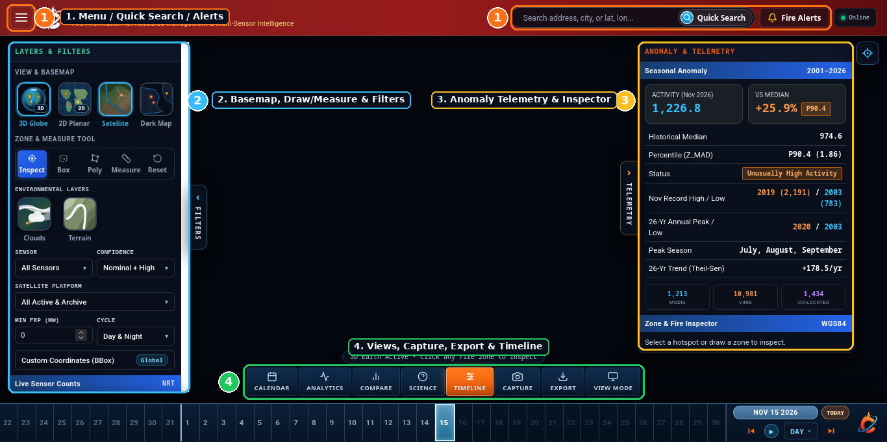
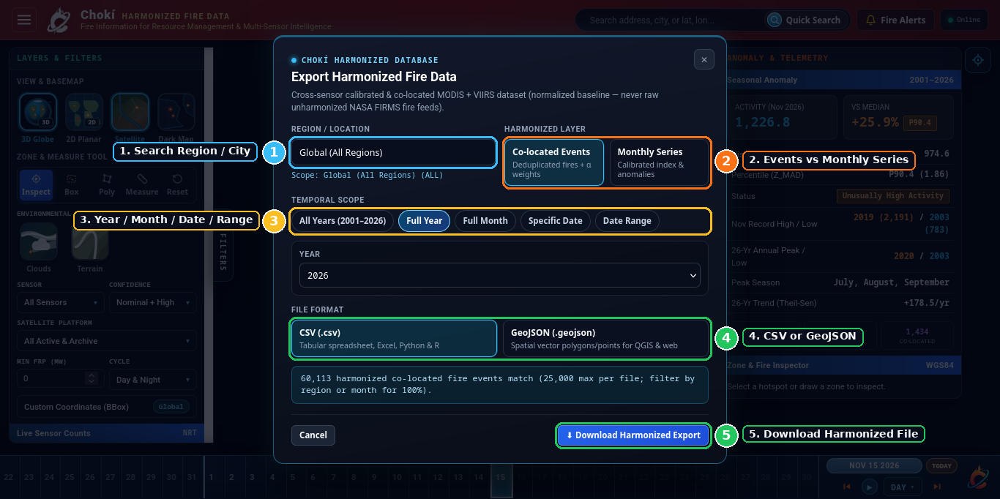
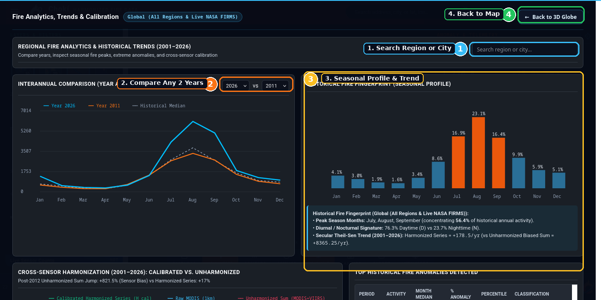

<p align="center">
  
</p>

# Choki — Global Fire Intelligence (GFI)

[English](README.md) | [Español](README-es.md)


**Choki** (Global Fire Intelligence — GFI) is a geospatial intelligence web platform that reconstructs a continuous, clean, and harmonized historical time series of forest fires from **2000 to 2026** by fusing thermal anomaly detections from **MODIS** and **VIIRS** satellite sensors without spatial duplication.

---

## Table of Contents

- [Project Description & Problem Statement](#project-description--problem-statement)
- [Project Status](#project-status)
- [How It Works](#how-it-works)
- [Key Features & Benefits](#key-features--benefits)
- [Project Goals](#project-goals)
- [Visual Demo](#visual-demo)
- [Technology Stack & Development Tools](#technology-stack--development-tools)
- [Architecture & Repository Structure](#architecture--repository-structure)
- [Prerequisites](#prerequisites)
- [Installation & Local Execution](#installation--local-execution)
- [Step-by-Step Docker Guide for Judges](#step-by-step-docker-guide-for-judges)
- [Scientific Verification & Tests](#scientific-verification--tests)
- [Build & Deployment](#build--deployment)
- [Team & Credits](#team--credits)
- [License](#license)
- [Support & Documentation](#support--documentation)
- [References](#references)

---

## Project Description & Problem Statement

Our platform addresses one of the most urgent environmental challenges encountered in the European Union in 2025. Analyses based on satellite data from the **European Forest Fire Information System (EFFIS)** revealed that **1,079,538 hectares** — an area roughly equivalent to the size of Cyprus — were devastated by fire across several EU countries.

Analyzing the real long-term progression of wildfires remains imprecise today because historical satellite archives suffer from:

- **Methodological discontinuities between sensors:** MODIS (`MCD14ML` / `MCD14DL`, 1 km nominal pixel resolution, active since the 2000s) and VIIRS (`VNP14IMGML`, `VJ114IMGML`, `VJ214IMGML`, 375 m I-band resolution, active since 2012) produce structurally different detection counts and radiative power metrics.
- **False negatives and false alarms:** Cloud cover obscures thermal signatures, while solar reflections and industrial heat sources introduce non-wildfire anomalies.
- **Sensor overlap duplication:** Combining VIIRS and MODIS using a static 1 km threshold results in double-counted fire detections for the same physical combustion event.

To unify multi-sensor records into a single scientifically consistent timeline, **Choki** applies the **Haversine** formula for spherical distance together with a dynamic footprint geometry rule:

$$d \le r_i + r_j + \delta$$

where $r_i$ and $r_j$ represent effective pixel radii derived from sensor `scan * track` geometry and $\delta$ represents the inter-sensor pointing tolerance (`0.65 km` in the harmonization engine within a `180`-minute co-location window).

---

## Project Status

- **Current State:** Functional full-stack prototype and pre-seeded scientific archive running locally on a custom Python HTTP/REST server (`server.py`, default port `8766`) and offline-capable web client (`web/`).
- **Pre-loaded Database (`data/gfi_fire_intelligence.sqlite`, 191 MB):** Contains 6 reference macro-regions (`MX-CHH`, `BR-AMZ`, `US-CAL`, `AU-NSW`, `RU-SAK`, `ES-IBE`), `281,280` indexed `raw_hotspots` (`hotspots_rtree`), `89,994` deduplicated `thermal_events`, `72` `calibration_models`, and `1,872` `harmonized_monthly_series` records.
- **Automated Scientific Validation:** `12` unit and mathematical validation tests passing in `tests/test_scientific_pipeline.py`.

---

## How It Works

1. **Multi-Sensor Ingestion (`pipeline/ingestor.py`, `pipeline/schemas.py`):** Loads historical archives and near-real-time (NRT) data from NASA FIRMS (`MCD14ML`, `MCD14DL`, `VNP14IMGML`, `VJ114IMGML`, `VJ214IMGML`) in 5-day chunks, normalizing confidence levels, satellite identifiers, and pixel `scan * track` footprint geometry via Pydantic v2 schemas.
2. **Spatial Indexing (`pipeline/database.py`):** Stores records in SQLite backed by a native **R-Tree** spatial index (`hotspots_rtree`) for sub-second bounding-box and polygon queries.
3. **Dynamic Co-Location & Calibration (`pipeline/harmonizer.py`):** Groups detections within the spherical Haversine footprint rule ($d \le r_i + r_j + \delta$) and time window (`180` minutes) into unique `thermal_events`, preventing MODIS/VIIRS double counting, and fits inter-sensor calibration ratios (`H_grid`, `H_cal`, `FRP_harm`).
4. **Statistical & Neural Audit (`pipeline/analytics.py`, `pipeline/choki_ai.py`):** Computes historical fire fingerprints, monthly burning calendars, Z-MAD anomaly classification, and Theil-Sen trend slopes. Includes custom-built neural networks (`TinyFireTransformer` with 2-head self-attention + GELU and `VerifierNetGatedResMLP` with GLU residual blocks inside `DualFireEnsemble`) built from scratch on a custom `MicroValue` autograd engine to audit harmonization quality and respond to analytical zone queries.
5. **Interactive Visualization & Export (`server.py`, `web/`, `pipeline/exporter.py`, `pipeline/harmonized_exporter.py`):** Serves an interactive web interface (HTML5/CSS3/JS + React 18.3.1 + PWA Service Worker) featuring color-coded burning calendars, spatial playback animations, and downloadable CSV and RFC 7946 GeoJSON reports.

---

## Key Features & Benefits

- **20+ Years of Unified History (2000–2026):** Bridges MODIS and VIIRS records into one continuous timeline without duplicate thermal alerts.
- **Interactive Color-Coded Burning Calendars & Spatial Animations:** Enables visual exploration of seasonal severity, anomaly spikes, and spatial progression across macro-regions or custom polygons.
- **Auditable Geospatial Exports:** Generates publication- and GIS-ready **CSV** and **GeoJSON (RFC 7946)** files (`pipeline/exporter.py`, `pipeline/harmonized_exporter.py`).
- **Offline-Resilient PWA & Near-Real-Time Sync:** Includes a Service Worker (`web/sw.js`), static fallback snapshot (`web/data/static_fallback.json`), and an optional background NRT sync daemon every `900` seconds (`15` minutes) when `FIRMS_MAP_KEY` is configured.

### Benefits

- Eliminates cross-sensor inflation when comparing pre-2012 MODIS records with post-2012 VIIRS observations.
- Accelerates ecological risk analysis for researchers, civil protection agencies, and environmental planners.
- Runs self-contained on standard local hardware without heavy external GIS database servers.

---

## Project Goals

1. Provide a reproducible, transparent baseline to measure long-term wildfire trends across vulnerable regions—such as the EU regions impacted in 2025—free from sensor-transition artifacts.
2. Democratize access to harmonized NASA FIRMS thermal data through an intuitive calendar, map, and export interface.
3. Combine classical spherical geometry, robust statistics (Theil-Sen / Z-MAD), and lightweight neural network auditing (`choki_ai.py`) into a fast, portable platform.

---

## Visual Demo

### Global Overview & Harmonized Timeline


### Geospatial Export Modal (CSV / GeoJSON)


### Analytics, Burning Calendar & Neural Audit


---

## Technology Stack & Development Tools

| Category | Project Profile & Verified Repository Implementation |
| :--- | :--- |
| **Development Tools** | Antigravity, Python standard tooling, Git |
| **Infrastructure & Technological Hosting** | Target hosting: Amazon Web Services (AWS) *(deployment manifests not yet included in this repository)*; Local HTTP runtime via `server.py` (`ThreadingHTTPServer` on port `8766`) |
| **Backend & API** | **Python** (`server.py`, `pipeline/*`, `scripts/*`) and **C++** *(declared in project stack; native C execution in repo is provided via SQLite R-Tree spatial engine, with no standalone `.cpp` files currently committed)* |
| **Frontend & UI** | **HTML5, JavaScript (ES6+), CSS3**, **React 18.3.1** (`web/vendor/` + `web/js/choki-react.js`), **html2canvas 1.4.1**, PWA Manifest & Service Worker (`web/manifest.webmanifest`, `web/sw.js`) |
| **Programming Languages** | Python (`3.14.10` verified), JavaScript, HTML, CSS *(C++ in declared project profile)* |
| **AI & Machine Learning** | Pure-Python custom autograd (`MicroValue`), `TinyFireTransformer` (2-head self-attention + GELU), `VerifierNetGatedResMLP` (GLU ResBlocks), and `DualFireEnsemble` in [`pipeline/choki_ai.py`](pipeline/choki_ai.py) |
| **Data Processing & Geospatial** | Python (`numpy 2.5.4`, `orjson 3.13.0`, `pydantic 2.14.2`, `sqlite3 3.54.0` R-Tree), Haversine dynamic geometry, Theil-Sen slope, Z-MAD anomaly scoring, GeoJSON RFC 7946 |
| **Async Tasks & Caching** | Python background daemon thread (`_start_nrt_auto_sync_loop(900)` in `server.py`), gzip compression, `ETag` HTTP caching, PWA Service Worker cache (`web/sw.js`) |
| **Software & Design** | HTML5, CSS3, React, SVG branding (`web/assets/logo/project-logo.svg`) |
| **Hardware** | Standard x86_64/ARM64 workstation or cloud compute instance (runs CPU-only, no dedicated GPU required) |
| **Data Sources** | NASA FIRMS (`MCD14ML`, `MCD14DL`, `VNP14IMGML`, `VJ114IMGML`, `VJ214IMGML`) & EFFIS EU 2025 wildfire reference context (`1,079,538 ha`) |

---

## Architecture & Repository Structure

Full architectural specifications and scientific formulas are documented in [PROJECT_BLUEPRINT.md](PROJECT_BLUEPRINT.md).

```text
.
├── server.py                       # HTTP/REST server, CSP headers, gzip/ETag, NRT sync loop (port 8766)
├── PROJECT_BLUEPRINT.md            # Scientific & architectural specification
├── LICENSE                         # MIT License (Copyright 2026 Chokí Harmonized Fire Data)
├── CREDITS.md                      # Team members, data sources & library credits
├── BUILD.md                        # Local & Docker build/execution instructions
├── CONTRIBUTING.md                 # Contribution guidelines & development workflow
├── SECURITY.md                     # Security policy, secret management & reporting
├── pipeline/
│   ├── __init__.py                 # Package version (1.0.0)
│   ├── schemas.py                  # Pydantic v2 validation & scan*track pixel geometry
│   ├── database.py                 # SQLite + R-Tree schema & 6 macro-regions
│   ├── ingestor.py                 # NASA FIRMS CSV/API ingestion & 5-day chunk sync
│   ├── harmonizer.py               # Haversine co-location (d <= r_i + r_j + delta) & calibration
│   ├── analytics.py                 # Burning calendars, Z-MAD, Theil-Sen, polygon queries
│   ├── choki_ai.py                 # Neural models (TinyFireTransformer, VerifierNetGatedResMLP)
│   ├── exporter.py                 # Raw & event CSV/GeoJSON exporter
│   └── harmonized_exporter.py      # Harmonized series CSV/GeoJSON (RFC 7946) exporter
├── scripts/
│   ├── sync_firms_area.py          # Area-based NASA FIRMS CLI sync utility
│   └── sync_global_firms_live.py   # Global live sync CLI script
├── tests/
│   └── test_scientific_pipeline.py # 12 scientific & mathematical validation unit tests
├── data/
│   └── gfi_fire_intelligence.sqlite # Pre-seeded 191 MB SQLite + R-Tree database
└── web/
    ├── index.html                  # Main SPA interface
    ├── js/                         # Application logic (app.js) & React components (choki-react.js)
    ├── vendor/                     # Local React 18.3.1 & html2canvas 1.4.1 bundles
    ├── data/static_fallback.json   # Offline static fallback dataset
    ├── assets/                     # Logo & tutorial screenshots
    ├── manifest.webmanifest        # PWA manifest
    └── sw.js                       # Service Worker for offline asset caching
```

---

## Prerequisites

- **For Native Local Execution:**
  - Python `3.10+` (verified on Python `3.14.10`) with SQLite `R-Tree` support enabled (`sqlite3 3.54.0` verified).
  - Python packages: `numpy`, `orjson`, `pydantic`, `requests`.
- **For Zero-Install Container Execution (Judges):**
  - Docker Engine / Docker Desktop only.
- **Optional (for live NASA FIRMS NRT synchronization):**
  - A NASA FIRMS `FIRMS_MAP_KEY` environment variable stored in `.env` (already ignored by `.gitignore`). The platform runs out-of-the-box offline with the pre-seeded SQLite archive (`data/gfi_fire_intelligence.sqlite`).

---

## Installation & Local Execution

1. **Clone the repository and enter the project directory:**

```bash
git clone <repository-url>
cd RoboTec-ITCH-standard-repo-template-main
```

2. **Install Python dependencies** *(note: `requirements.txt` is `[TO BE ADDED]`; install verified packages directly)*:

```bash
python3 -m pip install numpy orjson pydantic requests
```

3. *(Optional)* **Configure NASA FIRMS API key in `.env`** if you want live NRT ingestion:

```bash
echo "FIRMS_MAP_KEY=your_firms_map_key_here" > .env
```

4. **Start the platform server:**

```bash
python3 server.py
```

5. **Open in your browser:**

Navigate to `http://127.0.0.1:8766` (or set a custom port with `PORT=8080 python3 server.py`).

To initialize/verify the database schema without starting the HTTP server:

```bash
python3 server.py --init-only
```

---

## Step-by-Step Docker Guide for Judges

> **Repository Note:** `Dockerfile` and `requirements.txt` are not yet committed in the repository tree (`[TO BE ADDED]`). Judges or maintainers can run the platform cleanly inside an isolated Docker container without installing Python libraries on the host by following these exact steps.

### Step 1: Verify Docker is Installed

```bash
docker --version
```

### Step 2: Create a `Dockerfile` in the Repository Root

Create a file named `Dockerfile` next to `server.py` with the following content:

```dockerfile
FROM python:3.12-slim

WORKDIR /app

# Install verified Python runtime dependencies
RUN pip install --no-cache-dir \
    numpy \
    orjson \
    pydantic \
    requests

# Copy repository files (including server.py, pipeline/, web/, data/)
COPY . /app

ENV PORT=8766
EXPOSE 8766

CMD ["python3", "server.py"]
```

> **Tip:** If your `.dockerignore` excludes `data/`, make sure `data/gfi_fire_intelligence.sqlite` is included or mounted via `-v "$(pwd)/data:/app/data"` so the pre-seeded 2000–2026 archive is immediately available.

### Step 3: Build the Docker Image

From the project root directory, run:

```bash
docker build -t choki-gfi:latest .
```

### Step 4: Run the Container

**Standard offline evaluation mode (using the pre-seeded database):**

```bash
docker run --rm -p 8766:8766 --name choki-app choki-gfi:latest
```

**With live NASA FIRMS synchronization (optional):**

```bash
docker run --rm -p 8766:8766 -e FIRMS_MAP_KEY="your_key_here" --name choki-app choki-gfi:latest
```

### Step 5: Access the Platform

Open your web browser and go to:

```text
http://localhost:8766
```

### Step 6: Stop the Container

Press `Ctrl + C` in the terminal running Docker, or run:

```bash
docker stop choki-app
```

---

## Scientific Verification & Tests

Run the full validation suite (`12` automated unit tests executed in an isolated `:memory:` SQLite database):

```bash
python3 tests/test_scientific_pipeline.py
```

Verified test results:

```text
Ran 12 tests in 3.940s — OK
```

The test suite (`test_01` through `test_12`) validates coordinate/schema ingestion, spatial R-Tree indexing, Haversine deduplication, inter-sensor calibration, harmonized monthly time series generation, burning calendar statistics, anomaly classification, neural audit workflows, and CSV/GeoJSON exports.

---

## Build & Deployment

- **Frontend Assets:** `web/` uses vanilla JS, CSS, HTML5, and bundled vendor libraries (`web/vendor/`), requiring no Node.js/Webpack compilation step. `server.py` automatically minifies and gzip-compresses responses with `ETag` caching.
- **Database Pre-Build / Seeding:** `python3 server.py --init-only` prepares the SQLite schema, while `scripts/sync_firms_area.py` and `scripts/sync_global_firms_live.py` perform automated region/global synchronization.
- **Cloud Hosting:** AWS deployment manifests and automated CI/CD workflows are currently `[TO BE DEFINED]`. See [BUILD.md](BUILD.md) for detailed build and container steps.

---

## Team & Credits

Developed by the **Chokí Harmonized Fire Data** team:

- **Kevin Alejandro Arzola Martinez**
- **Angela Karyme Gamboa Enriquez**
- **Said Lobato Mende**
- **Mauricio Gómez Márquez**
- **Paulina Villalba Anchondo**

Full attributions for scientific datasets, satellite instruments, and open-source software are available in [CREDITS.md](CREDITS.md).

---

## License

This project is distributed under the **MIT License** — Copyright (c) 2026 Chokí Harmonized Fire Data. See [LICENSE](LICENSE) for complete terms.

---

## Support & Documentation

- **Build & Container Instructions:** [BUILD.md](BUILD.md)
- **Security Policies:** [SECURITY.md](SECURITY.md)

---

## References

1. **NASA FIRMS (Fire Information for Resource Management System):** MODIS (`MCD14ML`, `MCD14DL`) and VIIRS (`VNP14IMGML`, `VJ114IMGML`, `VJ214IMGML`) active fire products — https://firms.modaps.eosdis.nasa.gov/
2. **EFFIS (European Forest Fire Information System):** Copernicus Emergency Management Service EU wildfire statistics (`1,079,538 ha` burned in 2025 analysis) — https://effis.jrc.ec.europa.eu/
